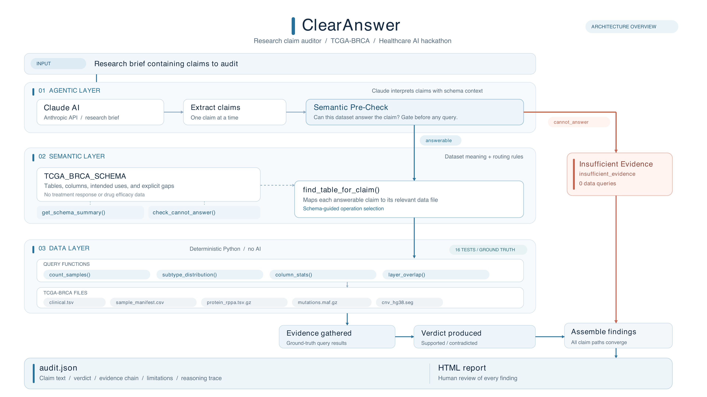

# ClearAnswer - Research Claim Auditor

**Track:** Evidence Navigator (Track 2)
**Team:** clearanswer (Gaurav Bohra, Ishika Gupta, Kush Patel)
**Hackathon:** OncoSys Cancer AI Lab, Northeastern University, Nov 2026

## What it does

Upload a research report in `.md`, `.txt`, or `.pdf`. ClearAnswer extracts the
factual sentences, checks every number in each sentence against the frozen
TCGA-BRCA release, and returns one of three verdicts per sentence:

- **supported** - the numbers match the data within rounding tolerance.
- **contradicted** - at least one number disagrees; the correct value is
  shown next to the claimed one.
- **insufficient evidence** - the data cannot speak to the claim (for
  example a treatment-response question that TCGA-BRCA does not record).

A reviewer can accept or override each verdict in the UI. Two artifacts
are exportable: the schema-valid `audit.json` for the organizers' checker,
and a standalone HTML report that drops into email or Slack.

**User:** a reviewer handed a report and asked "can we trust this?"

**Workflow:** upload report -> extract claims -> query data -> review
verdicts -> export `audit.json` and/or HTML report.

## How it works

Three layers, separated so each can be swapped or tested on its own:

1. **Agentic layer.** Claude extracts one claim per sentence from the
   uploaded report, then runs a per-claim verification loop. The agent
   plans what to look up, the tools run the actual pandas query, and the
   agent calls `finalize_verdict` with the verdict, correct value, and a
   claim-specific impact analysis (why it matters, next step).
2. **Semantic layer.** A schema file ([core/semantic.py](core/semantic.py))
   describes every column, its allowed values, and an explicit
   `cannot_answer` list (treatment response, hormone therapy, drug efficacy,
   causal claims). A pre-check against this list short-circuits claims the
   data cannot answer, so the agent does not waste tool calls on them.
3. **Data layer.** Deterministic pandas functions in
   [core/data_model.py](core/data_model.py) are what actually produce
   numbers. They are unit-tested against the real TCGA-BRCA files in
   [core/tests/test_data_model.py](core/tests/test_data_model.py) (16
   tests covering ground-truth counts like "1,101 primary tumors", "535
   with all 5 layers", "LumA is ~49.9% of primary tumors with a PAM50 call").

A numeric tolerance check in [core/tolerance.py](core/tolerance.py) runs
after the agent emits its verdict: if Claude labels something contradicted
but the numbers are within +/-0.5pp on decimal percentages (or +/-1.5pp on
"about X" claims), the verdict is upgraded to supported with a note.

Architecture follows Anthropic's "Building Effective Agents"
Orchestrator-Workers pattern.

## Architecture diagram



## Setup

```bash
git clone https://github.com/GauravBohra2001/clearanswer.git
cd clearanswer
python -m venv venv && source venv/bin/activate
pip install -r requirements.txt
git clone https://github.com/disleveK/oncosys-hackathon-challenge.git
python oncosys-hackathon-challenge/data/tcga-brca/fetch.py
cp .env.example .env                     # add your ANTHROPIC_API_KEY
PORT=5050 python app.py                  # open http://localhost:5050
```

`.env` must contain:

```
ANTHROPIC_API_KEY=your-key-here
```

Port 5000 is taken by macOS AirPlay Receiver on recent macOS versions,
which is why the default example uses `PORT=5050`.

## Practice envelope

Unseal the practice envelope to get the fresh TCGA-BRCA release files:

```bash
python oncosys-hackathon-challenge/envelopes/unseal.py practice orange meadow pilot lantern
```

The practice envelope ships only the `release/` folder plus a `README.txt`.
It does NOT include a `claim_auditor_report.md`. For the report, upload the
practice brief that lives in the challenge repo:

```
oncosys-hackathon-challenge/products/research-claim-auditor/practice_brief.md
```

On Saturday the judging envelope DOES ship a `claim_auditor_report.md`
alongside the release. The flow then is:

```bash
python oncosys-hackathon-challenge/envelopes/unseal.py <E??> <four-word code>
# then upload envelopes/opened/E??/claim_auditor_report.md in the UI
```

## Export

Two exports, both available from the Done state in the UI:

- **Export audit.json** - shared-format v0.2. Validates cleanly under
  `python oncosys-hackathon-challenge/format/validate.py outputs/audit-*.json`.
- **Download HTML report** - self-contained page (inline CSS, no JS, no
  remote assets). Useful for emailing or printing a frozen copy.

Both exports include any reviewer accept/override decisions made in the UI
before the export click. A contradicted finding whose reviewer "approved"
the claim appears as supported in the export, with `tool_verdict` and
`reviewer_reason` preserved for audit trail.

## API endpoints

| Route | Purpose |
|---|---|
| `POST /api/audit` | Start an audit (JSON `{report_text}` or multipart file) |
| `GET /api/status/<job>` | Poll state: `queued`/`extracting`/`verifying`/`done`/`error` |
| `GET /api/result/<job>` | Full audit dict once done |
| `POST /api/export/<job>` | Write audit.json + validate |
| `GET /api/export/download/<job>` | Download the written audit.json |
| `GET|POST /api/report/<job>/download.html` | Standalone HTML report (POST body carries reviewer overrides) |

## Third-party code

- anthropic (MIT) - Claude API SDK
- pandas (BSD-3-Clause) - data analysis
- Flask (BSD-3-Clause) - web server
- jsonschema (MIT) - shared-format validation
- cryptography (Apache-2.0) - opens sealed envelopes
- pdfplumber (MIT) - extracts text from uploaded PDFs

## Demo video

[link placeholder]
